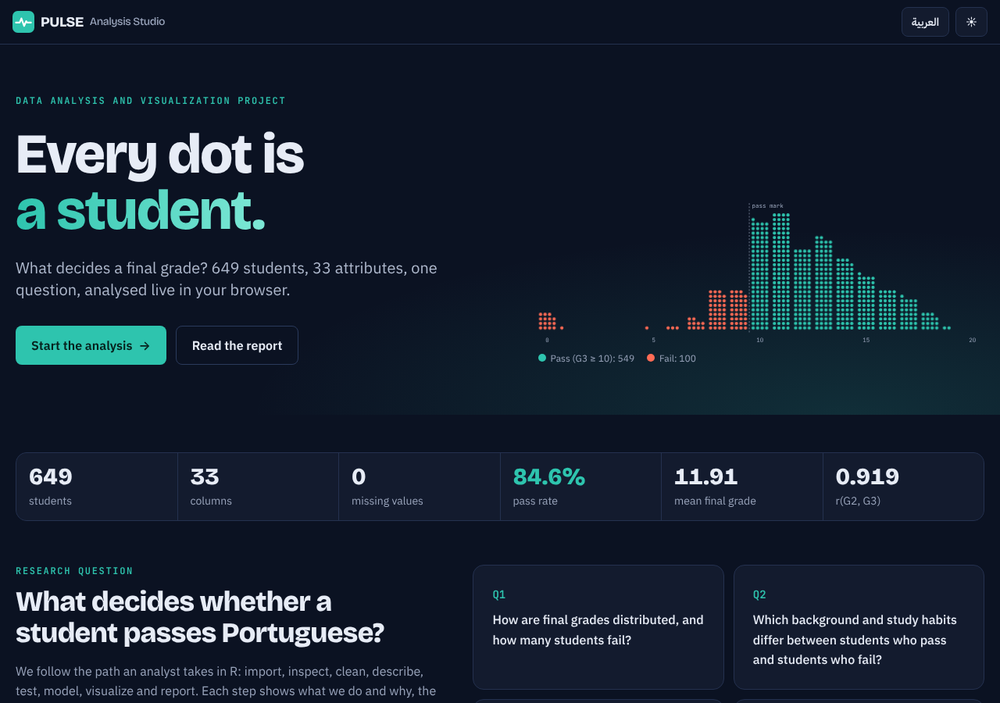
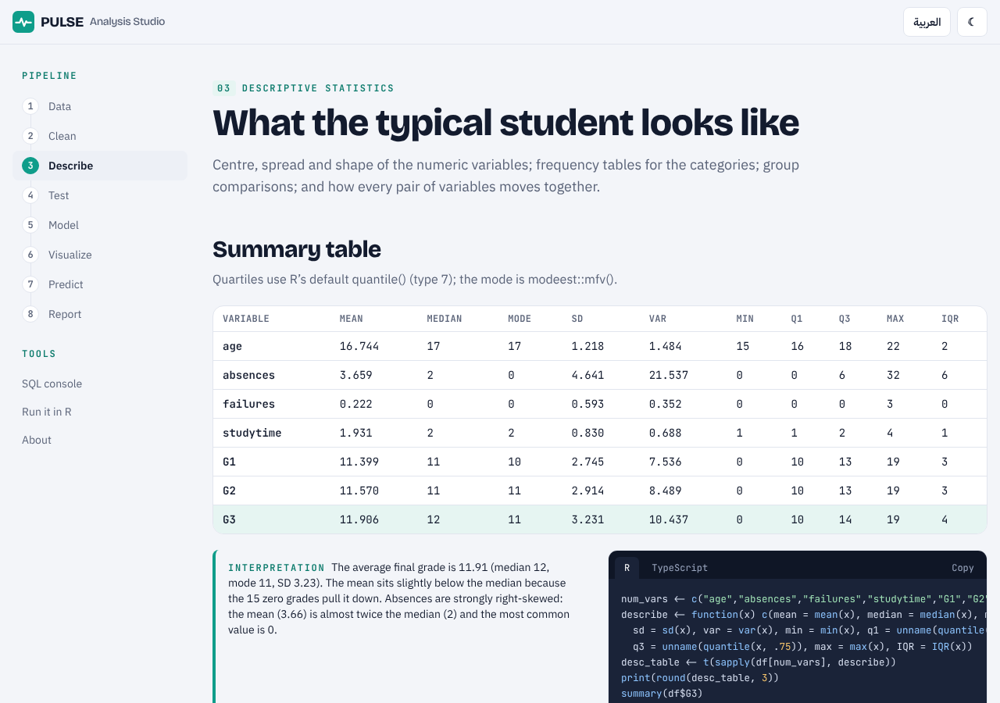
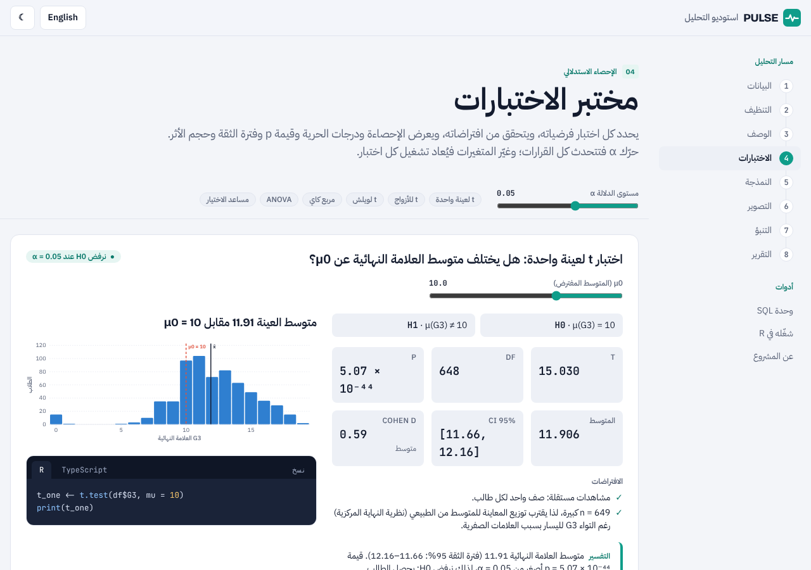
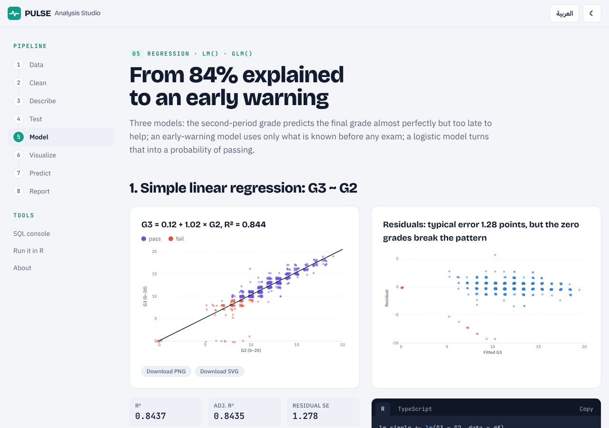
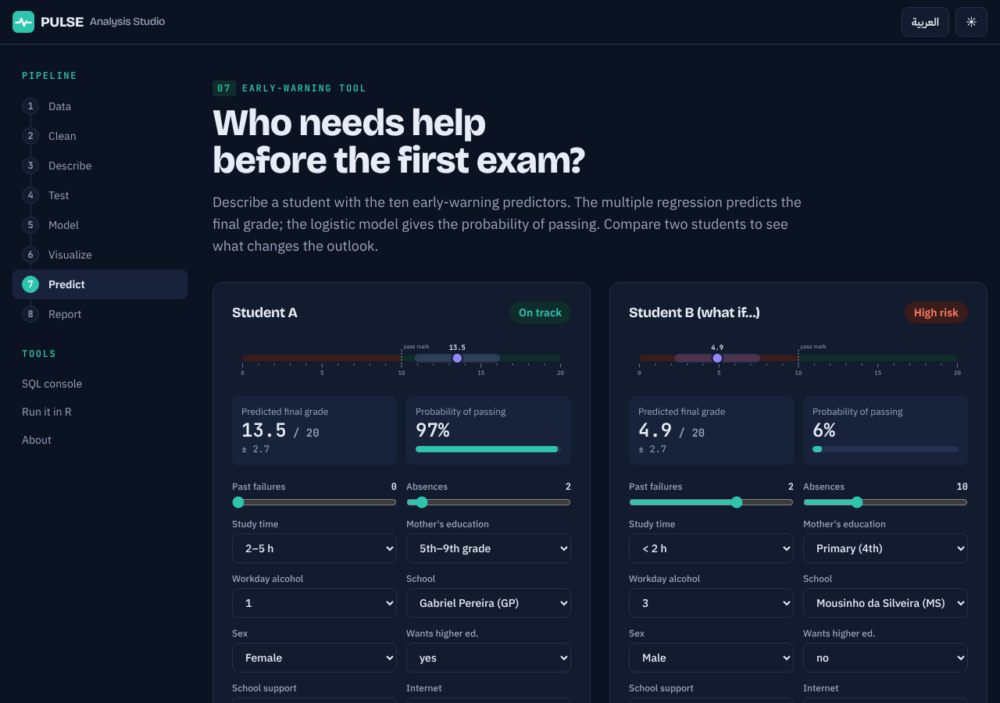

# PULSE Analysis Studio

**Live site: https://rayanobidi00-png.github.io/pulse-analysis-studio/**

A complete data-analysis project, *Predicting and Understanding Learning Success in Education*, performed live in the browser. The site loads the raw UCI Student Performance data (Portuguese course, 649 students × 33 columns), then inspects, cleans, describes and tests it, fits models, draws charts and writes up the results, the way an analyst works in R. Each step shows what is done and why, the live result, the R code from the course, the TypeScript that produced the number, and an interpretation in English and Arabic.

Built for the *Data Science Programming (R)* course. Team and instructor details are in [`src/content/team.ts`](src/content/team.ts).



| | |
|---|---|
|  |  |
|  |  |

## What is inside

| Route | Stage |
|---|---|
| `#/` | Hero dot plot of all students, live KPIs, research question |
| `#/data` | Import animation, SQL + R side by side, column dictionary with sparklines, SQL-backed data explorer |
| `#/clean` | 8 runnable cleaning steps with R and TypeScript code, before/after counts, decisions and reasons, 5 % missing-value simulation, `students_clean` (43 columns) |
| `#/describe` | Summary table (type-7 quartiles), frequency and group pickers, 16 × 16 Pearson/Spearman heat-map with click-through scatter and `cor.test` |
| `#/test` | One-sample, paired and Welch t-tests, chi-square, ANOVA + Tukey HSD, α slider, variable pickers, test chooser |
| `#/model` | `lm(G3 ~ G2)`, early-warning multiple regression with live refit, logistic regression with threshold slider, confusion matrix and ROC/AUC |
| `#/visualize` | Chart studio (histogram, box, bar, grouped bar, pie, scatter) with PNG/SVG download, plus the original ggplot2 gallery |
| `#/predict` | Early-warning tool: predicted grade on a 0–20 ruler, pass probability, risk label, what-if comparison |
| `#/r` | webR runs `pulse_analysis.R` section by section in the browser; R vs TypeScript comparison panel |
| `#/report` | Full generated report, download as PDF (print) or Markdown |
| `#/about` | Team, citation, methodology, limitations |

## How the numbers are verified

- No statistic is typed by hand. Every number is computed at runtime from `data/student-por.csv` by the engine in [`src/stats/`](src/stats) (quantiles type 7, Welch t-tests, chi-square without continuity correction, one-way ANOVA + Tukey HSD, OLS, logistic regression by IRLS exactly like `glm.fit`).
- [`data/results.json`](data/results.json) is the ground truth exported by [`data/pulse_analysis.R`](data/pulse_analysis.R). The Vitest suite ([`tests/`](tests)) compares every statistic with it: tolerance 1e-3 for statistics, 1e-4 relative for p-values above 1e-10, and the same order of magnitude below that.
- The SQL cleaning pipeline is tested to produce exactly the same `students_clean` table as the TypeScript pipeline.
- `npm run verify` checks the data contract (649 × 33, 0 NA, mean G3 = 11.906, 43 clean columns …) and fails if any ground-truth value appears as a literal in the UI code.
- On `#/r`, R itself (webR) can recompute everything in the browser, and the side panel compares it with the TypeScript engine row by row.

## Run locally

```bash
npm ci
npm run dev        # http://localhost:5173
npm run test       # Vitest: statistics vs R
npm run verify     # data contract + no hard-coded statistics
npm run build      # production build in dist/
```

Node 20 or newer. The CSV is bundled, so the site works offline after the first visit (a service worker caches it). Only the `#/r` page downloads webR and its packages from `webr.r-wasm.org`.

## Stack

Vite · React 18 · TypeScript (strict) · Tailwind CSS · React Router (hash) · jStat (distribution functions) · D3 scales and shapes · webR · Vitest · GitHub Pages via GitHub Actions. Design decisions are logged in [`docs/DECISIONS.md`](docs/DECISIONS.md); the build log is in [`docs/PROGRESS.md`](docs/PROGRESS.md).

## Data

P. Cortez and A. Silva. *Using Data Mining to Predict Secondary School Student Performance.* Proceedings of 5th FUBUTEC 2008, pp. 5–12, Porto, Portugal. UCI Machine Learning Repository, Student Performance, CC BY 4.0.

